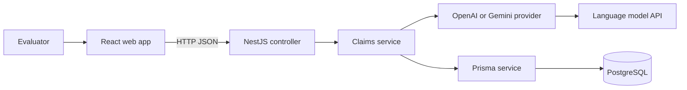

# L'Oréal Claims Intelligence Engine

This project demonstrates how an evaluator can compare a cosmetic product claim with a submitted clinical study summary, review the model's reasoning, and keep each assessment in PostgreSQL. It implements the evaluator step of the proposed business workflow; it does not make a scientific or regulatory decision on behalf of a human reviewer.

## Business workflow

1. A business team proposes product claims.
2. Claim managers screen claims for applicability and feasibility.
3. Scientists formulate and test products.
4. An evaluator submits the claim and a de-identified study summary.
5. The API asks a configured language model to assess whether the evidence supports the exact claim.
6. The result is saved and shown in the web app. An evaluator can expand a saved claim to review prior assessments or submit another assessment for the same claim.

## What the application does

- Accepts product name, proposed wording, optional target population, and a study evidence summary.
- Validates requests in the API before any model call.
- Returns `JUSTIFIED`, `NOT_JUSTIFIED`, or `INCONCLUSIVE`, with confidence, reasoning, and limitations.
- Stores claims and their assessments in PostgreSQL. A claim can have multiple assessments.
- Shows the latest result and saved assessment history in the React interface.
- Supports OpenAI, Gemini, and an explicit demo provider. Demo results are marked as such and real provider failures do not silently fall back to demo mode.

## Architecture



The web and API are independent projects with their own `package.json`, npm lockfile, environment file, README, and start command. The browser never receives the model key or database URL.

### Why these technologies

- **React + TypeScript** keep the form, result panel, and saved-claim history as small reusable UI components with typed API data.
- **NestJS** provides a clear place for HTTP routes, DTO validation, dependency injection, and service logic.
- **Prisma** keeps database reads and writes typed and puts the Claim/Assessment relationship in one schema with versioned migrations.
- **PostgreSQL** stores durable claims and assessment history, rather than keeping application data in process memory.
- **OpenAI** is the primary provider because the assignment explicitly asks for an OpenAI assessment. Gemini remains an optional provider behind the same assessment contract so it can be removed after comparison if it is not needed.

## Data model

`Claim` stores the proposed claim wording, product name, optional population, and creation time. `Assessment` stores one submitted evidence summary and its result. The `Assessment.claimId` foreign key points to `Claim.id`, so one claim can have multiple assessment rows. The database relation cascades assessment deletion if its claim is deleted.

When the API receives a `claimId`, it checks that claim first and attaches a new assessment to it. Without `claimId`, it creates a claim and its first assessment together in a Prisma nested write. The nested write is atomic: the parent and assessment are saved together or neither is saved. See the [Prisma transaction and nested write guidance](https://www.prisma.io/docs/orm/v6/prisma-client/queries/transactions).

## API

### `POST /api/claims/assess`

Create a claim with its first assessment:

```json
{
  "productName": "Revitalift sample serum",
  "claimText": "Reduces wrinkles by 20% in 4 weeks",
  "population": "Adults aged 40–65",
  "evidence": "A de-identified summary of the study, including its design, sample size, measured outcome, effect size and statistical results."
}
```

To assess an existing claim again, send only its ID and the new evidence. The API loads the claim wording, product name, and population from PostgreSQL:

```json
{
  "claimId": "claim-id-from-a-previous-response",
  "evidence": "A new de-identified study summary."
}
```

The response contains the saved claim and assessment:

```json
{
  "claimId": "claim-id",
  "claim": "Reduces wrinkles by 20% in 4 weeks",
  "productName": "Revitalift sample serum",
  "assessment": {
    "id": "assessment-id",
    "claimId": "claim-id",
    "evidence": "A de-identified study summary.",
    "verdict": "NOT_JUSTIFIED",
    "confidence": 0.82,
    "reasoning": "The submitted study does not establish the full effect size stated in the claim.",
    "limitations": ["The study summary does not include enough information to assess all outcomes."],
    "model": "gpt-4o-mini",
    "isDemo": false,
    "createdAt": "2026-10-31T04:07:03.677Z"
  }
}
```

The exact result depends on the supplied evidence and configured model. Confidence is the model's estimate, not a calibrated clinical probability.

Other routes used by the web app:

- `GET /api/claims` returns saved claims with their latest assessment summary.
- `GET /api/claims/:id/assessments` returns the claim and all its assessments, newest first. The UI calls this when a saved claim is expanded.

The assess route accepts POST because it requires a JSON body. Opening it in a browser address bar sends GET and is not a valid assessment request.

## Run locally

Use Node.js 20 or later. Keep the API and web app in separate terminals.

### API and database

```powershell
cd api
npm install
Copy-Item .env.example .env
```

Set `DATABASE_URL` and the model provider in `api/.env`, then start the API:

```powershell
npm run dev
```

For local PostgreSQL, the `dev` script starts the included local database helper and applies the committed Prisma migrations before starting NestJS. For Docker, use `docker compose up -d` from `api`. For hosted PostgreSQL, put its connection URL in `DATABASE_URL`; do not commit `.env`.

The API listens on `http://localhost:3000`. Prisma Studio can show the stored rows:

```powershell
npm run db:studio
```

### Web app

In a second terminal:

```powershell
cd web
npm install
npm run dev
```

Open the Vite URL printed in the terminal, normally `http://localhost:5173`. Local `/api` requests are proxied to the API. Set `VITE_API_URL` only when using a separately hosted API.

## Environment variables

The API reads configuration from `api/.env`:

| Variable | Purpose |
| --- | --- |
| `DATABASE_URL` | PostgreSQL connection string |
| `AI_PROVIDER` | `openai`, `gemini`, or `demo` |
| `OPENAI_API_KEY` | Server-side OpenAI API key |
| `OPENAI_MODEL` | OpenAI model name; defaults to `gpt-4o-mini` |
| `GEMINI_API_KEY` | Server-side Gemini API key |
| `GEMINI_MODEL` | Gemini model name; defaults to `gemini-3.5-flash-lite` |
| `PORT` | API port; defaults to `3000` |
| `WEB_ORIGIN` | Allowed production web origin; local development accepts localhost ports |

OpenAI is the default in `.env.example` to match the assignment. Use a key with API access and available quota; a ChatGPT subscription key is not an API key. Do not paste provider keys into the frontend or commit them.

## Tests and build

Build the API, then run its backend tests:

```powershell
cd api
npm run build
npm test
```

Build the web app:

```powershell
cd web
npm run build
```

The backend suite has unit tests for the service and provider error paths, plus HTTP controller tests that start a Nest app on an ephemeral local port and exercise the real route and `ValidationPipe`. Prisma and model providers are mocked in these tests. They do not connect to PostgreSQL or external model APIs, so this project does not currently have database integration tests. The web project has no separate component-test runner configured; its production build is checked with TypeScript and Vite.

GitHub Actions runs `npm ci`, Prisma Client generation, the API build and backend tests, then installs and builds the web app. It does not need API keys or a live database.

## Research performed and design decisions

I reviewed the official NestJS validation, Prisma transaction, OpenAI structured output, and Gemini structured output documentation before settling the request and persistence flow. The API uses NestJS `ValidationPipe` with whitelisting, so undeclared request fields are rejected. Both providers request structured JSON and the API validates the returned values again before persistence; structured output does not replace application-level validation. Prisma nested writes keep creation of a new Claim and its first Assessment together. The references are the [NestJS validation guide](https://docs.nestjs.com/techniques/validation), [OpenAI structured outputs guide](https://platform.openai.com/docs/guides/structured-outputs), [Gemini structured output guide](https://ai.google.dev/gemini-api/docs/structured-output), and [Prisma transaction guide](https://www.prisma.io/docs/orm/v6/prisma-client/queries/transactions).

OpenAI and Gemini providers return the same small assessment shape. The shared service owns provider selection, response handling, and database persistence. This avoids putting model-specific code in the controller or frontend. A 30-second provider timeout prevents a slow upstream call from holding the request indefinitely. Provider failures return an error; demo mode runs only when explicitly selected or when neither provider key nor provider selection is configured.

## Known limitations

- The model reviews a text summary and cannot verify the original report, source data, or study authenticity.
- Confidence has not been calibrated against expert-reviewed cases.
- The prototype has no authentication, roles, approval workflow, or audit controls.
- The API expects the user to provide a de-identified text summary; it does not ingest clinical PDFs.
- A model result is decision support only. A qualified human evaluator remains responsible for scientific and regulatory review.

## Roadmap

1. Add human evaluator review, approval, and a permanent audit trail.
2. Add role-based access, privacy controls, and retention policies.
3. Ingest clinical reports with page-level citations and evidence provenance.
4. Add retrieval-augmented search over approved scientific sources.
5. Evaluate model output against expert-labeled cases, then monitor quality and drift.
6. Add portfolio analytics after the review workflow and data governance are established.
